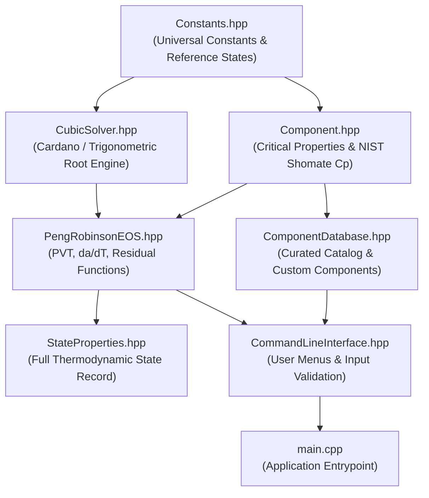

# CHL2002 Thermodynamics Project: Implementation Roadmap & Architecture

**Document Version:** 1.1 (Audited)  
**Phase:** Engineering Architecture & Milestone Planning  
**Target Completion:** Prior to November 10, 2026 Submission  

---

## 1. Modular C++ Architecture & Directory Layout

The application follows a modular, layered C++17 design adhering to the Single Responsibility Principle:

```text
Thermo Software/
├── CMakeLists.txt              # Top-level reproducible build configuration
├── README.md                   # User guide, build instructions, and verification summary
├── .gitignore                  # Git ignore rules for build artifacts and IDE cache
├── docs/
│   ├── PROJECT_SPECIFICATION.md # Complete equations, thermodynamic foundations, references
│   ├── IMPLEMENTATION_ROADMAP.md# Phased milestone schedule, dependencies, test plan
│   ├── SESSION_1_5_AUDIT.md    # Historical thermodynamic audit report & reproducible benchmarks
│   └── REPORT_DRAFT.md         # 4-page technical report draft mapped to assignment criteria
├── include/
│   └── thermo/
│       ├── Constants.hpp       # Universal constants (R, standard conditions, precision epsilons)
│       ├── Component.hpp       # PureComponent data model and NIST Shomate Cp integration methods
│       ├── ComponentDatabase.hpp# Curated catalog (8 gases) and custom component registry
│       ├── CubicSolver.hpp     # Analytical cubic equation solver (Cardano + Trigonometric)
│       ├── PengRobinsonEOS.hpp # PR parameters (a, b, da/dT), PVT calculations, departure functions
│       ├── StateProperties.hpp # Comprehensive thermodynamic state container (Z, v, H, S, phi, f)
│       └── CommandLineInterface.hpp # Interactive menu, input validation, formatted reporting
├── src/
│   ├── Component.cpp
│   ├── ComponentDatabase.cpp
│   ├── CubicSolver.cpp
│   ├── PengRobinsonEOS.cpp
│   ├── CommandLineInterface.cpp
│   └── main.cpp                # Application entry point
├── tests/
│   ├── CMakeLists.txt          # Test build target configuration
│   ├── test_cubic_solver.cpp   # Cubic polynomial solver unit tests
│   ├── test_components.cpp     # Component database and Shomate Cp integration tests
│   ├── test_pvt_eos.cpp        # PVT consistency, inverse PVT, ideal-gas limits
│   ├── test_thermo_derivatives.cpp # Finite-difference validation of da/dT
│   ├── test_departure_properties.cpp# Residual enthalpy, entropy, and fugacity benchmarks
│   └── test_literature_benchmarks.cpp# End-to-end validation against NIST and textbook cases
└── data/                       # Optional structured component definition files if required
```

---

## 2. Module Responsibilities & C++ Interface Contracts



### 2.1 Interface Declarations

#### A. `Component.hpp`
```cpp
namespace thermo {

struct ShomateParameters {
    double A{0.0}, B{0.0}, C{0.0}, D{0.0}, E{0.0}; // J/(mol*K), t = T/1000
    double T_min{298.15}, T_max{1200.0};            // K

    [[nodiscard]] double evaluate_cp(double T) const;
    [[nodiscard]] double integrate_cp(double T_ref, double T) const;
    [[nodiscard]] double integrate_cp_over_T(double T_ref, double T) const;
    [[nodiscard]] bool is_within_range(double T) const noexcept;
};

struct PureComponent {
    std::string name;
    std::string formula;
    double molar_mass{0.0};  // kg/mol
    double Tc{0.0};          // K
    double Pc{0.0};          // Pa
    double omega{0.0};       // dimensionless
    ShomateParameters shomate;
    std::string citation;    // Data provenance (e.g. NIST SRD 69)

    [[nodiscard]] bool is_valid() const noexcept;
};

} // namespace thermo
```

#### B. `CubicSolver.hpp`
```cpp
namespace thermo {

enum class RootType {
    SINGLE_REAL,
    VAPOR_LIKE,
    LIQUID_LIKE,
    UNSTABLE_INTERMEDIATE,
    NON_PHYSICAL
};

struct CubicRoot {
    double value{0.0};
    RootType type{RootType::SINGLE_REAL};
    double poly_residual{0.0};
};

struct CubicSolution {
    int num_real_roots{0};
    std::vector<CubicRoot> roots;
    double discriminant{0.0};
};

class CubicSolver {
public:
    // Solves monic real cubic: Z^3 + c2*Z^2 + c1*Z + c0 = 0
    // Pure mathematical solver; independent of thermodynamic filtering
    [[nodiscard]] static CubicSolution solve(double c2, double c1, double c0);
};

} // namespace thermo
```

---

## 3. Phased Implementation Roadmap

```mermaid
gantt
    title CHL2002 Development Roadmap
    dateFormat  YYYY-MM-DD
    section Specification & Foundations
    Session 1 : Spec, Equations & Architecture :done, 2026-10-20, 1d
    Session 1.5 : Independent Thermodynamic Audit :done, 2026-10-20, 1d
    section Core Infrastructure
    Session 2 : Components, Database & Cubic Solver :active, 2026-10-20, 2d
    section Thermodynamic Engine
    Session 3 : PR EOS Forward/Inverse PVT :2026-10-22, 2d
    Session 4 : Departure Enthalpy, Entropy & Fugacity :2026-10-24, 2d
    section Testing & Benchmarks
    Session 5 : Automated Test Suite & Literature Validation :2026-10-26, 2d
    section UI & Reporting
    Session 6 : Interactive CLI & Error Handling :2026-10-28, 2d
    section Final Report & Packaging
    Session 7 : 4-Page Technical Report & Packaging :2026-10-30, 3d
```

### Phase Breakdown & Dependencies

| Phase / Session | Objective | Key Deliverables | Pre-requisites | Measurable Completion Criteria |
| :--- | :--- | :--- | :--- | :--- |
| **Session 1** | Specification, Foundations & Architecture | `PROJECT_SPECIFICATION.md`, `IMPLEMENTATION_ROADMAP.md`, `.gitignore`, git init | Course Prompt | Approved engineering specification; zero unverified equations. (Done) |
| **Session 1.5** | Independent Thermodynamic Audit | `SESSION_1_5_AUDIT.md`, numerical benchmarks recalculated | Session 1 | Discrepancies resolved; NIST Shomate parameters verified; gate approved. (Done) |
| **Session 2** | Core Data Types & Cubic Solver | `Constants.hpp`, `Component.hpp/cpp`, `ComponentDatabase.hpp/cpp`, `CubicSolver.hpp/cpp`, tests | Session 1.5 | All unit tests pass (83/83); solves cubics with residual $\le 10^{-12}$; 8 gases verified. (Done) |
| **Session 3** (Completed) | PR EOS Engine & PVT Calculations | `PengRobinsonEOS.hpp/cpp` (PVT forward/inverse), `StateProperties.hpp`, `test_pvt_eos.cpp` | Session 2 | 100% tests pass (113/113 assertions); $P(T, v) == P$ reciprocity $\le 10^{-10}$; mechanical stability verified. (Done) |
| **Session 4** (Completed) | Departure Functions & Fugacity | $H^{\text{res}}, S^{\text{res}}, \phi, f$, small-$B$ Taylor regularization, Shomate $C_p$ integrals, Total $H/S$, Phase Preference | Session 3 | 100% tests pass (133/133 assertions); $\lim_{P\to 0}\phi = 1.0, H^{\text{res}} \to 0$; Maxwell identity error $\le 10^{-12}$. (Done) |
| **Session 5** (Completed) | Test Suite & Literature Validation | Complete test suite in `tests/`, benchmark validation tables, differential Maxwell/Gibbs–Helmholtz cross-checks | Session 4 | 100% test pass rate across 4 CTest targets (346/346 assertions); Gibbs–Helmholtz & Simpson quadrature verified. (Done) |
| **Session 6** | CLI & Usability Polish | Interactive command-line interface with formatted outputs, input guardrails | Session 5 | Robust user workflow, handles invalid input gracefully, viva ready. |
| **Session 7** | Final Technical Report & Archive | 4-page LaTeX/Markdown report, final submission archive | Session 6 | Technical report fully aligned with actual program outputs. |

---

## 4. Test & Validation Plan

### 4.1 Layer 1: Mathematical Limits & Asymptotic Checks
1. **Ideal Gas Limit ($P \to 0$):**
   - At $T = 300\text{ K}$, evaluate at $P = 10\text{ Pa}, 1\text{ Pa}, 10^{-2}\text{ Pa}$:
     - $Z \to 1.00000000$ (residual $\le 1.0 \times 10^{-7}$)
     - $\phi \to 1.00000000$ (residual $\le 1.0 \times 10^{-7}$)
     - $H^{\text{res}} \to 0.00\text{ J/mol}$
     - $S^{\text{res}} \to 0.00\text{ J/(mol*K)}$
2. **Cubic Root Inversion:**
   - Every evaluated root $Z$ must satisfy $|Z^3 + c_2 Z^2 + c_1 Z + c_0| \le 1.0 \times 10^{-12}$ (regular states).
3. **EOS Reciprocity Check:**
   - Compute $v = Z R T / P$. Evaluate $P_{\text{calc}} = P(T, v)$.
   - Acceptance: $|P_{\text{calc}} - P| / P \le 1.0 \times 10^{-10}$ for $P \ge 10^{-2}\text{ Pa}$.

### 4.2 Layer 2: Analytical Derivative Cross-Validation
The analytical derivative $\frac{da}{dT}$ is verified against central finite differences:
$$\left( \frac{da}{dT} \right)_{\text{num}} = \frac{a(T + \delta) - a(T - \delta)}{2\delta}, \quad \delta = 10^{-5} T$$
- Acceptance criteria: Relative discrepancy $\left| \frac{(da/dT)_{\text{ana}} - (da/dT)_{\text{num}}}{(da/dT)_{\text{ana}}} \right| \le 1.0 \times 10^{-7}$.

### 4.3 Layer 3: Audited Benchmark Verification Cases

In the table below, the exact values calculated from the Peng–Robinson 1976 EOS serve as the **software test expectations**. External experimental values (from NIST Chemistry WebBook SRD 69) are listed alongside for physical reference:

| Case ID | Substance | State ($T, P$) | PR-1976 Software Test Expectation (Exact EOS Solution) | External Database / Real-Fluid Value (NIST SRD 69) | Model Classification & Phase Stability |
| :--- | :--- | :--- | :--- | :--- | :--- |
| **BM-01** | **Methane** | $300\text{ K}, 5.0\text{ MPa}$ | $Z = 0.901844$<br>$v = 4.4990 \times 10^{-4}\text{ m}^3/\text{mol}$<br>$\phi = 0.901385$<br>$H^{\text{res}} = -902.34\text{ J/mol}$ | $Z_{\text{real}} \approx 0.892$<br>$v_{\text{real}} \approx 4.45 \times 10^{-4}\text{ m}^3/\text{mol}$<br>$\phi_{\text{real}} \approx 0.895$<br>$H_{\text{real}}^{\text{res}} \approx -980\text{ J/mol}$ | Supercritical single-phase vapor ($\Delta > 0$, 1 root). Mechanically stable ($\partial P/\partial v < 0$). |
| **BM-02** | **Carbon Dioxide** | $300\text{ K}, 4.0\text{ MPa}$ | $Z = 0.752334$<br>$v = 4.6914 \times 10^{-4}\text{ m}^3/\text{mol}$<br>$\phi = 0.795528$<br>$H^{\text{res}} = -1990.99\text{ J/mol}$ | $Z_{\text{real}} \approx 0.758$<br>$v_{\text{real}} \approx 4.73 \times 10^{-4}\text{ m}^3/\text{mol}$<br>$\phi_{\text{real}} \approx 0.798$<br>$H_{\text{real}}^{\text{res}} \approx -2050\text{ J/mol}$ | Subcritical vapor ($\Delta > 0$, 1 root, below liquid spinodal). Mechanically stable. |
| **BM-03** | **Carbon Dioxide** | $300\text{ K}, 7.0\text{ MPa}$ | $Z = 0.198057$<br>$v = 7.0575 \times 10^{-5}\text{ m}^3/\text{mol}$<br>$\phi = 0.638285$<br>$H^{\text{res}} = -9374.37\text{ J/mol}$ | $Z_{\text{real}} \approx 0.185$<br>$v_{\text{real}} \approx 6.59 \times 10^{-5}\text{ m}^3/\text{mol}$<br>$\phi_{\text{real}} \approx 0.612$<br>$H_{\text{real}}^{\text{res}} \approx -10150\text{ J/mol}$ | Compressed liquid ($\Delta > 0$, 1 root, above vapor spinodal). Mechanically stable. |
| **BM-04** | **Propane** | $320\text{ K}, 1.0\text{ MPa}$ | **3 Real Roots ($\Delta < 0$):**<br>Root 1 (liq): $Z = 0.036453, \phi = 1.2393$<br>Root 2 (mid): $Z = 0.091826$ (unstable)<br>Root 3 (vap): $Z = 0.850555, \phi = 0.8680$<br>$H_{\text{vap}}^{\text{res}} = -1131.04\text{ J/mol}$ | $Z_{\text{real,vap}} \approx 0.843$<br>$\phi_{\text{real,vap}} \approx 0.862$<br>$H_{\text{real,vap}}^{\text{res}} \approx -1220\text{ J/mol}$ | Subcritical two-phase region. Vapor root is globally stable ($\phi_{\text{vap}} < \phi_{\text{liq}}$). Middle root discarded. |

---

## 5. Report Structure & Page Budget Plan (Max 4 Pages)

Strict 4-page allocation for final technical report:

1. **Page 1: Introduction, Objectives, and Thermodynamic Foundations**
   - Scope of project and problem statement.
   - Governing Peng–Robinson EOS formulations and parameter derivations ($a_c, b, \alpha(T), \kappa, da/dT$).
   - Dimensionless polynomial formulation in $Z$.
2. **Page 2: Residual Properties, Pure Fugacity, and Reference States**
   - Exact derivation and analytical equations for $H^{\text{res}}$, $S^{\text{res}}$, and $\ln \phi$.
   - Authentic NIST Shomate integration and reference state definition ($T_{\text{ref}} = 298.15\text{ K}, P_{\text{ref}} = 1.0\text{ bar}$).
   - Low-pressure asymptotic Taylor regularization.
3. **Page 3: Software Architecture, Numerical Algorithm, and Stability Criterion**
   - C++ modular design and execution workflow.
   - Depressed cubic Cardano and Vieta trigonometric root solver.
   - Physical root filtering ($Z > B$), mechanical stability ($\partial P/\partial v < 0$), and fugacity phase stability criterion.
4. **Page 4: Verification Results, Discussion, Limitations, and Conclusions**
   - Tabulated verification against PR-1976 exact benchmarks and physical comparisons with NIST data.
   - Derivative finite-difference validation and reciprocity checks.
   - Model limitations (pure components only, polar fluids, supercritical liquid density accuracy).
   - Traceable bibliography and references.
